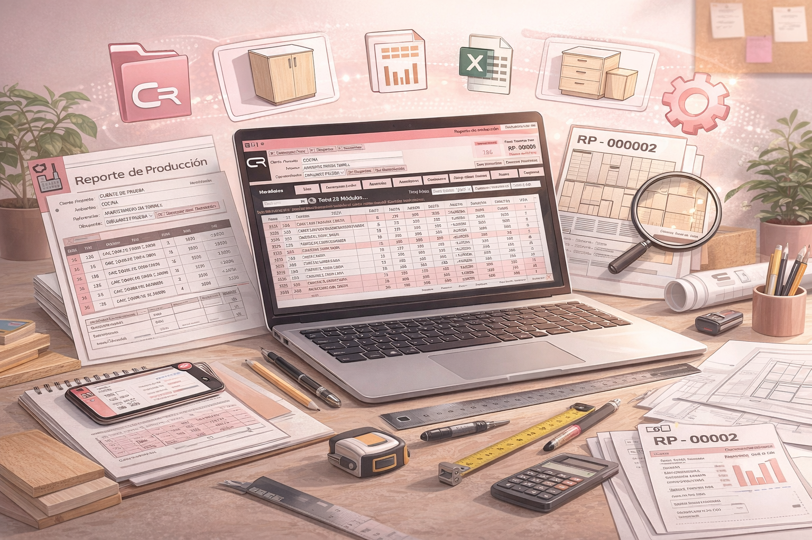

# Manual de usuario

[🏠 Volver al portal principal de Cabinet Report](https://danielmelendez-pma.github.io/cabinet-report-partners/)

**CABINET REPORT · APRENDE A UTILIZAR EL SOFTWARE**

## Comienza con lo esencial

Esta sección te orienta para aprender a utilizar Cabinet Report en la **planificación y preparación de la fabricación de muebles**. Encontrarás el acceso al curso de uso y las páginas de referencia para consultar cada herramienta.

<figure><figcaption>
Aprende a tu ritmo y consulta las herramientas cuando las necesites.
</figcaption></figure>


**El curso se encuentra en un sitio de aprendizaje independiente.** Puedes abrirlo desde el enlace siguiente y regresar a esta documentación para consultar las características y condiciones de cada función.


[**📘 Abrir el curso de Cabinet Report ↗**](https://cabinet-report.gitbook.io/curso-de-cabinet-report/)

## Ruta recomendada para empezar


{% column width="50%" %}
### 1. Accede a tu cuenta

Comprueba que tienes tus credenciales y la licencia correspondiente. Familiarízate con la ventana principal.

[Inicio de sesión](funcionalidades-de-cabinet-report/inicio-de-sesion.md) · [Licencia de cliente](funcionalidades-de-cabinet-report/licencia-de-cliente.md)

### 2. Organiza tu proyecto

Conoce cómo localizar proyectos y utilizar los módulos disponibles como punto de partida.

[Explorador de proyectos](funcionalidades-de-cabinet-report/explorador-de-proyectos.md) · [Catálogo de módulos](funcionalidades-de-cabinet-report/catalogo-de-modulos.md)

{% column width="50%" %}
### 3. Prepara piezas y materiales

Revisa dimensiones, espesores, cantidades, vetas y cantos antes de generar los archivos.

[Creador de módulos](funcionalidades-de-cabinet-report/creador-de-modulos.md) · [Creador de piezas](funcionalidades-de-cabinet-report/creador-de-piezas.md)

### 4. Revisa y genera la producción

Consulta el reporte, las comprobaciones disponibles y las herramientas de optimización según tu licencia.

[Reporte de producción](funcionalidades-de-cabinet-report/reporte-de-produccion.md) · [Revisor IA](funcionalidades-de-cabinet-report/revisor-inteligencia-artificial.md) · [Optimizadores](funcionalidades-de-cabinet-report/optimizadores.md)



## Después del primer Reporte de Producción

Una vez revisado el despiece, elige la continuación que necesites. **No es obligatorio utilizar todas las herramientas en un mismo proyecto**:

- **Preparar el corte:** consulta los [Optimizadores](funcionalidades-de-cabinet-report/optimizadores.md) y confirma el material, las piezas y las restricciones de la máquina.
- **Planificar compras o cotizar:** revisa el [Reporte de compras](funcionalidades-de-cabinet-report/reporte-de-compras.md) y, cuando corresponda, continúa en [Costos y cotizaciones](funcionalidades-de-cabinet-report/costos-en-desarrollo.md).
- **Agrupar trabajos de fabricación:** conoce la [Orden de producción](funcionalidades-de-cabinet-report/orden-de-produccion.md).
- **Retomar una revisión asistida:** consulta [Auditoría RP y persistencia](funcionalidades-de-cabinet-report/auditoria-rp-persistencia.md) para comprobar decisiones y recuperación de la producción.

## Antes de enviar información al taller

1. Comprueba que **las medidas, los materiales y las cantidades** correspondan al proyecto.
2. Revisa los avisos del sistema y los hallazgos de IA, si la función está habilitada.
3. Verifica el contenido de los archivos generados y que el destinatario pueda utilizarlos.
4. Conserva una copia de la información necesaria para realizar correcciones.


**La revisión humana sigue siendo obligatoria.** Una producción generada, una optimización terminada o una revisión IA sin hallazgos no garantiza la ausencia de errores.


## ¿Necesitas ayuda?

Consulta las [Políticas de Soporte](politicas-de-soporte.md) para conocer el alcance de la asistencia y los [canales oficiales](redes-sociales.md) para encontrar novedades. Si vas a solicitar ayuda, identifica la versión instalada, el módulo afectado y los mensajes que aparecen. No compartas contraseñas ni credenciales.

También puedes revisar la [Política de Capacitación e Implementación](politica-de-capacitacion-e-implementacion.md) y las [funcionalidades disponibles](funcionalidades-de-cabinet-report/README.md).

---

[← Volver al inicio de Cabinet Report](README.md)
